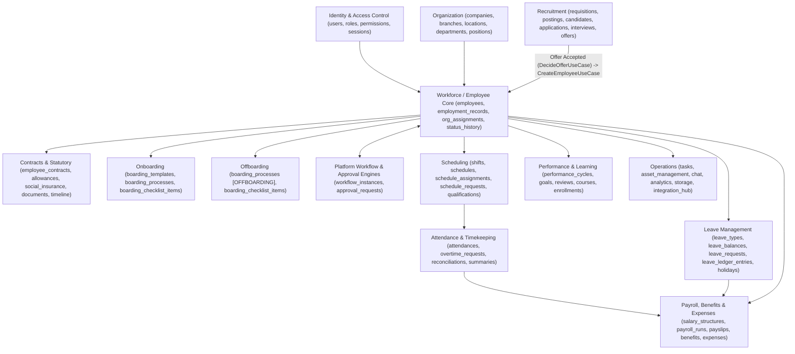

# HRMS Domain Map & Module Boundaries

## 1. Domain Overview

---

## 2. Backend Module Inventory (`apps/api/src/modules/`)

| Domain Group | Module Path | Core Aggregate Tables | Primary Controllers | Facade / Cross-Module Contract |
|---|---|---|---|---|
| **Identity & RBAC** | `modules/identity` | `users`, `roles`, `permissions`, `user_roles`, `role_permissions`, `user_permissions`, `sessions` | `AuthController`, `UsersController`, `RolesController`, `PermissionsController`, `AccessControlController` | `IdentityAdminPort` (`IDENTITY_ADMIN_PORT`), `SecurityRepository` |
| **Organization** | `modules/organization` | `companies`, `branches`, `locations`, `departments`, `positions` | `DepartmentsController`, `PositionsController`, `LocationsController` | `DepartmentReaderPort`, `PositionReaderPort` |
| **Workforce / Employee Core** | `modules/workforce/employees` | `employees`, `employment_records`, `org_assignments`, `employee_status_history`, `employee_educations`, `employee_certifications` | `EmployeesController`, `EmployeeAdminController`, `DepartmentEmployeesController`, `EmployeeEducationController` | `EmployeeLifecycleService`, `EmployeeReaderPort` |
| **Contracts & Statutory** | `modules/workforce/{employee-contracts,employee-allowances,employee-social-insurance,employee-documents,employee-timeline,labor-report,gps-logs}` | `employee_contracts`, `employee_allowances`, `employee_social_insurance`, `employee_documents`, `gps_logs` | `EmployeeContractsController`, `EmployeeAllowancesController`, `EmployeeSocialInsuranceController`, `EmployeeDocumentsController`, `EmployeeTimelineController`, `LaborReportController`, `GpsLogsController` | `EmployeeContractsRepository`, `EmployeeTimelineModule` |
| **Recruitment** | `modules/recruitment` | `requisitions`, `job_postings`, `candidates`, `applications`, `application_stage_events`, `interviews`, `scorecards`, `offers` | `RequisitionsController`, `PostingsController`, `CandidatesController`, `InterviewsController`, `OffersController`, `PipelineController` | `DecideOfferUseCase` (`CandidateHiredEvent`) -> `CreateEmployeeUseCase` |
| **Onboarding** | `modules/onboarding` | `boarding_templates`, `boarding_template_items`, `boarding_processes`, `boarding_checklist_items` | `BoardingTemplateController`, `BoardingProcessController` | `IBoardingProcessReader`, `CreateOnboardingProcessUseCase` |
| **Offboarding** | `modules/offboarding` | `boarding_processes` (`type = 'OFFBOARDING'`), `boarding_checklist_items` | `OffboardingController` | `OffboardingEventListener` (`EmployeeTerminatedEvent`), `IBoardingProcessReader` |
| **Scheduling** | `modules/scheduling` | `shifts`, `schedules`, `schedule_assignments`, `schedule_requests`, `qualifications`, `employee_qualifications` | `ShiftsController`, `ScheduleCoreController`, `ScheduleRequestsController`, `QualificationsController` | `SchedulingFacade` |
| **Attendance** | `modules/attendance` | `attendances`, `attendance_events`, `overtime_requests`, `attendance_reconciliations`, `attendance_summaries` | `AttendanceCommandController`, `AttendanceQueryController`, `TimekeepingController`, `OvertimeController`, `ReconciliationController`, `AttendanceSummariesController` | `AttendanceFacade` |
| **Leave Management** | `modules/leave` | `leave_types`, `leave_policies`, `leave_balances`, `leave_requests`, `leave_ledger_entries`, `holidays` | `LeaveManagementController`, `LeaveAdminController` | `LeaveFacade` |
| **Payroll, Benefits & Expenses** | `modules/payroll`, `modules/benefits`, `modules/expenses` | `salary_structures`, `payroll_periods`, `payroll_runs`, `payroll_items`, `payslips`, `benefit_plans`, `employee_benefits`, `expense_claims` | `PayrollController`, `PayrollPeriodsController`, `PayrollRunsController`, `PayslipsController`, `SalaryStructuresController`, `PayrollDashboardController`, `BenefitsController`, `ExpensesController` | `PayrollFacade` |
| **Performance & Learning** | `modules/performance`, `modules/learning` | `performance_cycles`, `performance_goals`, `performance_reviews`, `courses`, `course_enrollments` | `PerformanceController`, `LearningController` | - |
| **Operations & Platform** | `modules/{tasks,asset-management,chat,analytics,storage,integration-hub,platform-*}` | `tasks`, `task_templates`, `assets`, `asset_assignments`, `chat_rooms`, `chat_messages`, `audit_logs`, `stored_files`, `workflow_instances`, `approval_requests`, `notifications` | `TasksController`, `CatalogController`, `InventoryController`, `AssetIssueController`, `AssetRequestController`, `ChatController`, `DashboardController`, `AuditLogsController`, `FilesController`, `UploadsController`, `WorkflowInstanceController`, `ApprovalRequestController`, `PlatformNotificationsController` | `WorkflowEngineService`, `ApprovalEngineService`, `EventOutboxService`, `StorageService` |
