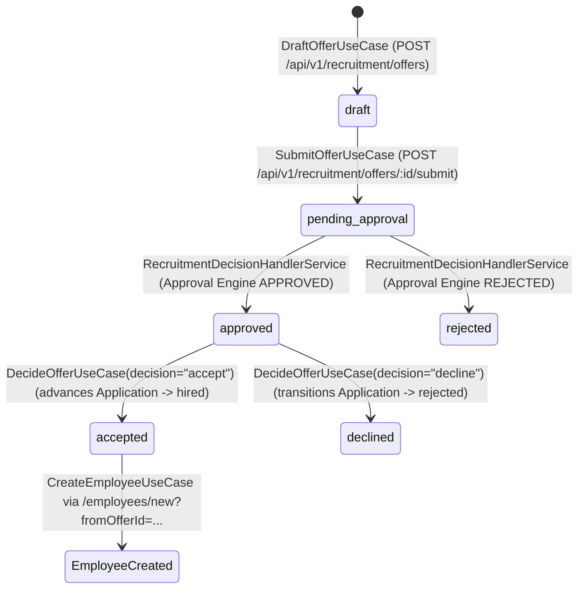
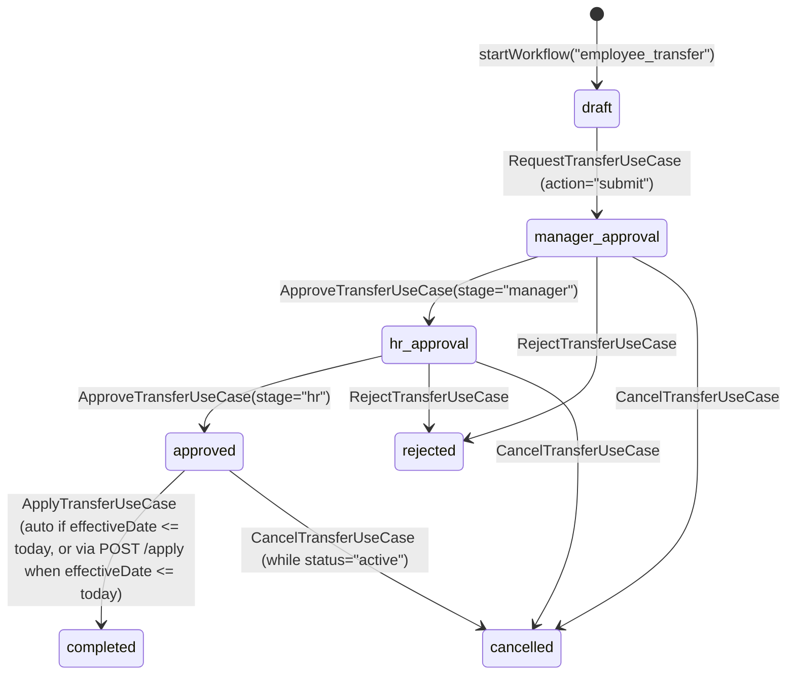
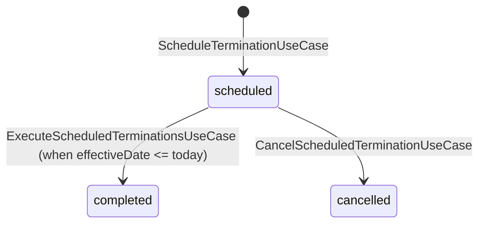

# Employee Lifecycle State Transitions Matrix

## 1. Aggregate State Machines

### 1.1. Recruitment Offer & Application Stage (`offers.status` & `applications.currentStage`)

Source of truth: [`decide-offer.usecase.ts`](file:///home/hieutt/btn-hrms/apps/api/src/modules/recruitment/offers/use-cases/decide-offer.usecase.ts), [`submit-offer.usecase.ts`](file:///home/hieutt/btn-hrms/apps/api/src/modules/recruitment/offers/use-cases/submit-offer.usecase.ts), [`recruitment-decision.handler.service.ts`](file:///home/hieutt/btn-hrms/apps/api/src/integration/recruitment-approval/recruitment-decision.handler.service.ts).

### 1.2. Employee Core Status (`employees.status` & `employees.deletedAt`)

Source of truth: [`status-transitions.ts`](file:///home/hieutt/btn-hrms/apps/api/src/modules/workforce/employees/domain/status-transitions.ts) & [`employee-lifecycle-state-machine.ts`](file:///home/hieutt/btn-hrms/apps/api/src/modules/workforce/employees/services/employee-lifecycle-state-machine.ts).

```mermaid
stateDiagram-v2
  [*] --> probation: CreateEmployeeUseCase (status="probation")
  [*] --> working: CreateEmployeeUseCase (status="working", default)
  probation --> working: ChangeEmployeeStatusUseCase (sets employment_records.confirmedAt)
  probation --> leave: ChangeEmployeeStatusUseCase
  probation --> suspended: ChangeEmployeeStatusUseCase
  probation --> terminated: TerminateEmployeeUseCase / ExecuteScheduledTerminationsUseCase
  working --> leave: ChangeEmployeeStatusUseCase
  working --> suspended: ChangeEmployeeStatusUseCase
  working --> retired: ChangeEmployeeStatusUseCase
  working --> terminated: TerminateEmployeeUseCase / ExecuteScheduledTerminationsUseCase
  leave --> working: ChangeEmployeeStatusUseCase
  leave --> suspended: ChangeEmployeeStatusUseCase
  leave --> retired: ChangeEmployeeStatusUseCase
  leave --> terminated: TerminateEmployeeUseCase / ExecuteScheduledTerminationsUseCase
  suspended --> working: ChangeEmployeeStatusUseCase
  suspended --> terminated: TerminateEmployeeUseCase / ExecuteScheduledTerminationsUseCase
  terminated --> working: RehireEmployeeUseCase (new employment_records, org_assignments, contract version+1)
  terminated --> probation: RehireEmployeeUseCase (status="probation")
  working --> Archived: DeleteEmployeeUseCase / BulkArchiveUseCase (sets deletedAt)
  probation --> Archived: DeleteEmployeeUseCase / BulkArchiveUseCase (sets deletedAt)
  leave --> Archived: DeleteEmployeeUseCase / BulkArchiveUseCase (sets deletedAt)
  suspended --> Archived: DeleteEmployeeUseCase / BulkArchiveUseCase (sets deletedAt)
  retired --> Archived: DeleteEmployeeUseCase / BulkArchiveUseCase (sets deletedAt)
  terminated --> Archived: DeleteEmployeeUseCase / BulkArchiveUseCase (sets deletedAt)
  Archived --> ActiveStatus: RestoreArchivedEmployeeUseCase (clears deletedAt for non-terminated; restores files)
  Archived --> RehiredStatus: RehireEmployeeUseCase (clears deletedAt for terminated; restores files)
  Archived --> [*]: PurgeEmployeeUseCase (hard delete after retention window)
```

### 1.3. Internal Transfer Workflow (`workflow_instances` — `employee_transfer`)

Source of truth: [`request-transfer.usecase.ts`](file:///home/hieutt/btn-hrms/apps/api/src/modules/workforce/employees/use-cases/request-transfer.usecase.ts), [`approve-transfer.usecase.ts`](file:///home/hieutt/btn-hrms/apps/api/src/modules/workforce/employees/use-cases/approve-transfer.usecase.ts), [`apply-transfer.usecase.ts`](file:///home/hieutt/btn-hrms/apps/api/src/modules/workforce/employees/use-cases/apply-transfer.usecase.ts).

### 1.4. Scheduled Termination Workflow (`workflow_instances` — `employee_termination`)

Source of truth: [`schedule-termination.usecase.ts`](file:///home/hieutt/btn-hrms/apps/api/src/modules/workforce/employees/use-cases/schedule-termination.usecase.ts), [`execute-scheduled-terminations.usecase.ts`](file:///home/hieutt/btn-hrms/apps/api/src/modules/workforce/employees/use-cases/execute-scheduled-terminations.usecase.ts), [`cancel-scheduled-termination.usecase.ts`](file:///home/hieutt/btn-hrms/apps/api/src/modules/workforce/employees/use-cases/cancel-scheduled-termination.usecase.ts).

---

## 2. Detailed State Transition & Invariant Table

| Current State | Target State | Operation / Endpoint | Actor / Permission | Preconditions / Guard Invariants | Side Effects (Transactional) | Post-Conditions & Outbox Events |
|---|---|---|---|---|---|---|
| `(Offer: approved, Application: offer)` | `(Offer: accepted, Application: hired)` -> `Employee: working \| probation` | `POST /api/v1/recruitment/offers/:id/decision` (`{ decision: "accept" }`) -> `POST /api/v1/employees` | `recruitment:offer:manage` -> `employee:create` (`EmployeePolicies.create`) | Offer `status === 'approved'`; on employee creation: valid `departmentId`/`positionId`, unique `username`, `email`, `employeeCode` | Creates `users` row, `employees` row (syncing `departmentId`, `currentEmploymentRecordId`, `currentOrgAssignmentId`), `employment_records` (`isCurrent=true`), `org_assignments` (`isCurrent=true`), `employee_contracts` (`version=1, isCurrent=true`), `employee_status_history` | `CandidateHiredEvent`, `EmployeeCreatedEvent`, `EmployeeHiredEvent` |
| `probation` (`deletedAt: null`) | `working` | `PUT /api/v1/employees/:id/change-status` (`{ status: "working" }`) | `employee:edit` (`EmployeePolicies.edit`) | `emp.status === 'probation'`, `!emp.deletedAt` | Updates `employees.status = 'working'`, sets `employment_records.confirmedAt = today`, inserts `employee_status_history` | `EmployeeStatusChangedEvent` |
| `probation \| working \| leave \| suspended` | `working \| leave \| suspended \| retired \| terminated` | `PUT /api/v1/employees/:id/change-status` or `PUT /api/v1/employees/:id` | `employee:edit` (`EmployeePolicies.edit`) | `assertStatusTransition(from, to)` passes; `!emp.deletedAt` | Updates `employees.status`, inserts `employee_status_history` | `EmployeeStatusChangedEvent` |
| `probation \| working` | `(Same status, new OrgAssignment)` | `POST /api/v1/employees/:id/transfers` -> `manager-approve` -> `hr-approve` -> `apply` | Request: `employee:manage`; Mgr Approve/Reject: `employee:view` (manager/dept scoped); HR Approve/Apply: `employee:manage`; Cancel: `employee:edit` | `assertLifecycleOperation("transfer", emp)` (`status in ['working', 'probation'] && !deletedAt`), no active transfer instance (`409 Conflict`), valid org refs & no manager cycle; on apply: `currentState === 'approved' && status === 'active'`, `effectiveDate <= today`, `expectedEmployeeId === instance.subjectId` | Closes current primary `org_assignments` (`isCurrent=false, effectiveTo`), inserts new `org_assignments` (`isCurrent=true`), updates `employees.departmentId` & `currentOrgAssignmentId`, inserts `employee_status_history` with current employee status, marks workflow `completed` | `EmployeeTransferRequestedEvent`, `EmployeeTransferApprovedEvent`, `EmployeeTransferAppliedEvent`, `EmployeeTransferCancelledEvent` |
| `probation \| working \| leave \| suspended` | `terminated` | `PUT /api/v1/employees/:id/terminate` | `employee:edit` (`EmployeePolicies.edit`) | `emp.status !== 'terminated'`, `!emp.deletedAt` | Updates `employees.status = 'terminated'`, clears `currentEmploymentRecordId` & `currentOrgAssignmentId`, closes current `employment_records` (`isCurrent=false, endDate`), closes current `org_assignments` (`isCurrent=false, effectiveTo`), closes `employee_contracts` (`isCurrent=false, status='terminated'`), deactivates `users` & revokes sessions, inserts `employee_status_history` | `EmployeeTerminatedEvent` -> triggers `OffboardingEventListener` (`INITIATED` offboarding process) |
| `probation \| working \| leave \| suspended` | `terminated` (Scheduled) | `POST /api/v1/employees/:id/schedule-termination` -> Cron `ExecuteScheduledTerminationsUseCase` | `employee:manage` / `employee:manage:sensitive` (`EmployeePolicies.terminate`) | `assertLifecycleOperation("schedule_termination", emp)`, `effectiveDate > today`, no existing active `employee_termination` instance (`409 Conflict`) | Starts `employee_termination` workflow (`scheduled`); on `effectiveDate <= today`, executes full termination side effects and transitions workflow to `completed` | `EmployeeTerminationScheduledEvent` -> `EmployeeTerminatedEvent` (or `EmployeeTerminationCancelledEvent` on `DELETE /api/v1/employees/:id/scheduled-termination`) |
| `terminated` (`deletedAt: null \| timestamp`) | `working \| probation` | `POST /api/v1/employees/:id/rehire` | `employee:manage` (`EmployeePolicies.manage`) | `emp.status === 'terminated'`, valid org refs & no manager cycle | Restores archive (`deletedAt = null`) and archived storage files if previously archived, closes any lingering `isCurrent=true` records/assignments/contracts, creates new `employment_records` (`isCurrent=true`), new `org_assignments` (`isCurrent=true`), new `employee_contracts` (`version = maxVersion + 1`), updates `employees` (`status`, `departmentId`, pointers), reactivates `users`, inserts `employee_status_history` | `EmployeeRehiredEvent` |
| `Any status` (`deletedAt: null`) | `Archived` (`deletedAt != null`) | `DELETE /api/v1/employees/:id` or `POST /api/v1/employees/bulk/archive` | `employee:delete` (`EmployeePolicies.delete`) | `!emp.deletedAt` | Sets `employees.deletedAt = now`, archives employee storage files (`storage.archiveOwnerFiles("employee", id)`) | Audit log `employee_delete` / `employee_bulk_archive` |
| `Archived` (`deletedAt != null, status !== 'terminated'`) | `Unarchived` (`deletedAt: null`) | `POST /api/v1/employees/:id/restore` | `employee:manage` (`EmployeePolicies.manage`) | `emp.deletedAt !== null`, `emp.status !== 'terminated'` (terminated employees must use `/rehire`) | Clears `employees.deletedAt = null`, restores archived storage files (`storage.restoreOwnerFiles("employee", id)`), inserts `employee_status_history` (`"Restored from archive"`) | Audit log `employee_restore` |
| `Archived` (`deletedAt != null` >= retention days) | `(Purged)` | `DELETE /api/v1/employees/:id/purge` | `sys:all` / SuperAdmin (`EmployeePolicies.purge`) | `emp.deletedAt !== null`, `daysSinceDeleted >= PURGE_RETENTION_DAYS` (default 90) | Purges storage files, deletes `employee_contracts`, deletes `employees` (cascading child tables), deletes `users` | Audit log `employee_purge` |
