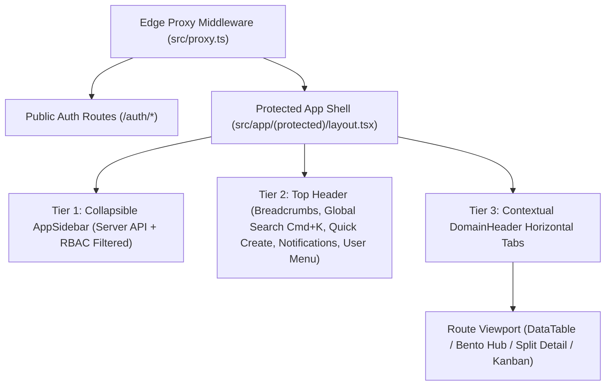

# Phase 2A — Information Architecture & Navigation Design

## 1. Navigation Architecture Overview

`btn-hrms` implements a **three-tier navigation hierarchy** designed to support 22 domain modules without overwhelming the user's primary viewport:

### 1.1 Tier 1 — Primary Sidebar (`AppSidebar`)
- **Source of Truth**: Fetched from `GET /api/v1/navigation` (`useNavigation()` in `src/hooks/use-nav.ts`), where `NavService` filters nodes against the authenticated user's JWT permissions and active module rollout flags (`src/config/module-rollout.ts`).
- **6 Top-Level Navigation Groups**:
  1. **Workspace (`Bàn làm việc`)**: `/workspace`, `/workspace/hr`, `/tasks`, `/chat`, `/account/notifications`
  2. **Time & Attendance (`Chấm công & Nghỉ phép`)**: `/attendance/my-attendance`, `/schedule/my-schedule`, `/leave/requests`
  3. **Workforce (`Hồ sơ & Tổ chức`)**: `/employees`, `/organization/departments`, `/onboarding`, `/offboarding`
  4. **Compensation (`Lương & Phúc lợi`)**: `/payroll/dashboard`, `/expenses`, `/benefits/plans`
  5. **Talent (`Tuyển dụng & Phát triển`)**: `/recruitment/requisitions`, `/performance/cycles`, `/learning/courses`, `/assets/catalog`
  6. **Administration (`Quản trị hệ thống`)**: `/administration/users`, `/administration/roles`, `/administration/approval`, `/administration/workflows`, `/administration/audit-logs`, `/admin/integrations`, `/admin/settings`, `/monitoring/system-health`

### 1.2 Tier 2 — Global Header & Command Palette (`Header`, `Command`)
- **Breadcrumbs**: Dynamic route-aware breadcrumb trail with localized Vietnamese labels (`src/lib/app-copy.ts`).
- **Command Search (`Cmd+K` / `Ctrl+K`)**: Instant keyboard navigation across all authorized routes and quick actions.
- **Notification Bell & User Menu**: Unread notification badge, theme switcher (`Light`, `Dark`, `Coral`, `Slate`, `Contrast`), profile shortcut (`/account/profile`), and sign-out action.

### 1.3 Tier 3 — Contextual Domain Tabs (`DomainHeader`)
Whenever a user enters a multi-screen domain, the domain's nested `layout.tsx` renders `<DomainHeader tabs={...} />` directly below the top bar so users can switch between sub-views in a single click:

| Domain Layout | Contextual Tabs Rendered |
| --- | --- |
| `attendance/layout.tsx` | Chấm công cá nhân (`/attendance/my-attendance`), Lịch sử (`/attendance/history`), Quản lý chấm công (`/attendance/management`), Tổng hợp (`/attendance/summary`), Phân tích (`/attendance/analytics`), Bảng công (`/attendance/timesheet-editor`), Nhật ký GPS (`/attendance/gps-logs`) |
| `schedule/layout.tsx` | Lịch của tôi (`/schedule/my-schedule`), Lịch tổng quan (`/schedule/calendar`), Quản lý ca (`/schedule/management`), Phân ca (`/schedule/roster`), Yêu cầu đổi ca/OT (`/schedule/requests`) |
| `leave/layout.tsx` | Đơn nghỉ phép (`/leave/requests`), Phê duyệt (`/leave/approvals`), Quỹ phép (`/leave/balance`), Chính sách (`/leave/policies`) |
| `employees/layout.tsx` | Danh sách nhân sự (`/employees`), Hợp đồng (`/employees/contracts`), Tài liệu (`/employees/documents`) |
| `organization/layout.tsx` | Phòng ban (`/organization/departments`), Sơ đồ tổ chức (`/organization/chart`), Vị trí công việc (`/organization/positions`) |
| `payroll/layout.tsx` | Tổng quan (`/payroll/dashboard`), Kỳ lương (`/payroll/periods`), Bảng lương (`/payroll/runs`), Phiếu lương (`/payroll/payslips`), Cơ cấu lương (`/payroll/salary-structures`) |
| `benefits/layout.tsx` | Gói phúc lợi (`/benefits/plans`), Đăng ký tham gia (`/benefits/enrollments`) |
| `recruitment/layout.tsx` | Yêu cầu tuyển dụng (`/recruitment/requisitions`), Tin tuyển dụng (`/recruitment/postings`), Ứng viên (`/recruitment/candidates`), Phỏng vấn (`/recruitment/interviews`), Đề nghị nhận việc (`/recruitment/offers`) |
| `performance/layout.tsx` | Chu kỳ đánh giá (`/performance/cycles`), Đánh giá năng lực (`/performance/reviews`), Mục tiêu OKR/KPI (`/performance/goals`) |
| `learning/layout.tsx` | Khóa học (`/learning/courses`), Chứng chỉ (`/learning/certifications`), Lộ trình học tập (`/learning/paths`) |
| `assets/layout.tsx` | Danh mục thiết bị (`/assets/catalog`), Tồn kho (`/assets/inventory`), Yêu cầu cấp phát (`/assets/requests`), Thiết bị đang cấp (`/assets/issues`) |
| `administration/layout.tsx` | Người dùng (`/administration/users`), Phân quyền (`/administration/roles`), Phê duyệt (`/administration/approval`), Quy trình động (`/administration/workflows`), Nhật ký hệ thống (`/administration/audit-logs`), Tích hợp & Webhook (`/admin/integrations`), Cấu hình hệ thống (`/admin/settings`) |
| `monitoring/layout.tsx` | Sức khỏe hệ thống (`/monitoring/system-health`), Hàng đợi xử lý (`/monitoring/queues`) |

---

## 2. Public vs. Protected Route Policies & Legacy Redirects

### 2.1 Public Routes (`src/app/auth/*`)
- `/auth/sign-in` — Primary credential login with `callbackUrl` preservation.
- `/auth/forgot-password` — Self-service password reset request.
- `/auth/reset-password` — Token-verified password reset form.
- `/unauthorized` — Explicit 403 Access Denied fallback page.

### 2.2 Edge Redirects & Canonicalization (`src/proxy.ts`)
To prevent dead links from bookmarks, notifications, or cross-module links:
- `/` $\rightarrow$ `/workspace` (when authenticated) or `/auth/sign-in` (when unauthenticated)
- `/dashboard`, `/dashboard/overview` $\rightarrow$ `/workspace`
- `/dashboard/workspaces`, `/dashboard/workspaces/team` $\rightarrow$ `/workspace/hr`
- `/leaves`, `/leaves/*` $\rightarrow$ `/leave/requests`
- `/departments`, `/departments/*` $\rightarrow$ `/organization/departments`
- `/positions`, `/positions/*` $\rightarrow$ `/organization/positions`
- `/approvals` $\rightarrow$ `/administration/approval`
- Base domain index paths (`/attendance`, `/schedule`, `/leave`, `/organization`, `/payroll`, `/administration`, `/monitoring`, `/account`) automatically redirect to their default sub-route.

---

## 3. Page-Level vs. Action-Level Permission Architecture

1. **Page-Level Gate (`<RequireRouteAccess>`)**:
   - Reads the current pathname, resolves its entry in `APP_ROUTES` (`src/shared/authorization/route-registry/routes.ts`), and checks `auth.anyPermissions`, `auth.allPermissions`, and `auth.roles`.
   - If unauthorized, renders an accessible restricted-access state with a clear explanation and link back to `/workspace` without leaking protected data.
2. **Action-Level Gate (`usePermissions` / `<PermissionGate>`)**:
   - Individual mutation controls (e.g., "Tạo bảng lương", "Tạo khóa học", "Tạo gói phúc lợi", "Phân công đánh giá", "Cấp chứng chỉ", "Nhập kho thiết bị") inspect the user's permissions (`learning:manage`, `benefits:manage`, `performance:manage`, `assets:manage`, `Payroll:create:all`, etc.) so standard employees only see self-service actions appropriate to their role.
