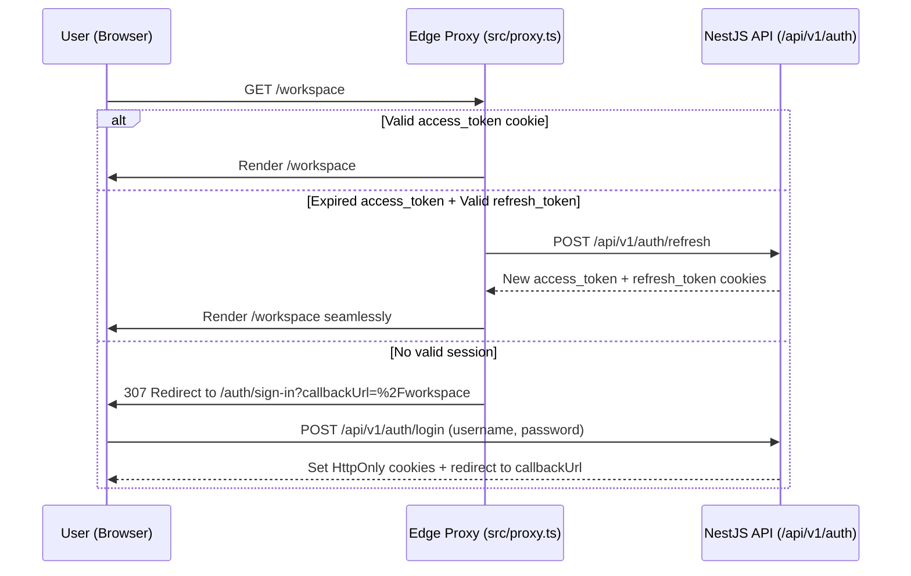
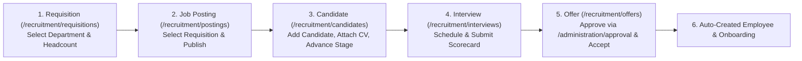

# Phase 3 — User Flows & Interaction Specification (`btn-hrms`)

Every interactive control in `btn-hrms` must map to a deterministic system response, loading state, validation boundary, and recovery path. Below are the 10 core end-to-end user journeys across the platform.

---

## Flow 1: Authentication, Session Refresh & Expiry Recovery

- **Starting Point**: Unauthenticated user visits any protected route or `/auth/sign-in`.
- **User Action**: Enters username/email and password, clicks `"Đăng nhập"`.
- **Loading State**: Submit button disables with spinner; inputs lock to prevent double submission.
- **Success Condition**: Cookies (`access_token`, `refresh_token`) are set; router navigates to `callbackUrl` (or `/workspace`).
- **Failure Path**: Invalid credentials return `401`; inline error alert displays localized reason; password field clears focus for retry.

---

## Flow 2: Daily Web Check-In / Check-Out with Camera & Lunch Duty

- **Starting Point**: `/attendance/my-attendance` (`MyAttendanceView`).
- **User Action**:
  1. Employee clicks `"Check-in"` or `"Check-out"` on the active session card (`morning`, `noon`, or `afternoon`).
  2. If `session === 'noon'` and `action === 'checkin'`, `LunchDutyDialog` opens first so the employee selects `indoor` (trực tại chỗ) or `outdoor` (ra ngoài).
  3. `CameraCaptureDialog` opens, streams webcam preview (or allows fallback file upload), and captures a timestamped photo.
- **Expected System Response**: Sends `multipart/form-data` via `POST /api/v1/attendance/check` with `date`, `session`, `type`, `imageSource`, `image`, and `lunchDutyType`.
- **Loading & Success State**: Button shows spinner during upload; on `200 OK`, `toast.success` fires, dialog closes, and `attendanceInvalidations.myMonth` + `todayAttendance` refresh the calendar grid immediately.
- **Failure & Recovery**: If camera permission is denied or network fails, `CameraCaptureDialog` stays open with an explicit retry/upload fallback and `toast.error`.

---

## Flow 3: Leave Request Submission, Multi-Step Approval & Trace Timeline

- **Starting Point**: `/leave/requests` (`LeaveRequestsPageClient`).
- **User Action**:
  1. Employee clicks `"Tạo đơn nghỉ phép"` $\rightarrow$ opens `CreateLeaveRequestDialog`.
  2. Selects leave policy, start/end dates, half-day options, and reason $\rightarrow$ clicks `"Gửi đơn"`.
  3. Manager/HR opens `/leave/approvals` (or `/administration/approval`), reviews request, and clicks `"Duyệt"` or `"Từ chối"`.
  4. Either party clicks a row in `LeaveRequestsTable` to open `LeaveRequestDetailDialog` and inspect `LeaveTraceTimeline`.
- **Validation & Failure Paths**: Overlapping dates or insufficient leave balance return `400/409` with `ERROR_REASONS`; dialog remains open preserving user input so dates can be adjusted.

---

## Flow 4: Employee 360° Lifecycle — Quick-Peek, Probation Evaluation & Offboarding

- **Starting Point**: `/employees` (`EmployeesTable`).
- **User Action**:
  1. HR clicks an employee row $\rightarrow$ `EmployeeSheetLayout` (Quick-Peek drawer) slides out from the right.
  2. HR can immediately click `"Đánh giá / Gia hạn thử việc"` inside Quick-Peek or click `"Mở hồ sơ đầy đủ"` to navigate to `/employees/[id]`.
  3. On `/employees/[id]`, `EmployeeLifecycleWorkflowHero` surfaces context-sensitive lifecycle actions based on employee status (`PROBATION` $\rightarrow$ Evaluate Probation; `ACTIVE` $\rightarrow$ Request Transfer / Change Status / Schedule Termination; `TERMINATED` $\rightarrow$ Rehire).
  4. Alternatively, an employee visits `/account/profile` and clicks `"Gửi đơn xin nghỉ việc"` to initiate self-resignation, which creates an offboarding workflow visible in `/offboarding`.

---

## Flow 5: Monthly Payroll Run — Provisional Calculation, Verification & Lock

- **Starting Point**: `/payroll/runs` (`PayrollRunsPageClient`).
- **User Action**:
  1. C&B Officer clicks `"Tạo bảng lương"`, selects an open Payroll Period, and submits (`POST /api/v1/payroll/runs`).
  2. Navigates to `/payroll/runs/[id]` (`PayrollRunDetailPageClient`).
  3. While in `DRAFT` or `CALCULATED` status, the header displays `data-testid="payroll-provisional-badge"` (`Tạm tính`) and `PayrollRunWorkflowHero`.
  4. Officer triggers `"Tính lương"` (`POST /api/v1/payroll/runs/:id/calculate`), reviews gross/BHXH/PIT/net line items, then clicks `"Chốt bảng lương"` (`lock`) and `"Đánh dấu đã chi trả"` (`mark-paid`).
- **Success Condition**: Status transitions `DRAFT` $\rightarrow$ `CALCULATED` $\rightarrow$ `LOCKED` $\rightarrow$ `PAID`; payslips become visible to employees in `/payroll/payslips`.

---

## Flow 6: End-to-End Recruitment Pipeline (Requisition $\rightarrow$ Posting $\rightarrow$ Candidate $\rightarrow$ Interview $\rightarrow$ Offer $\rightarrow$ Auto-Hire)

- **Interaction Specification**:
  - **Step 1 (`RequisitionsView`)**: Manager clicks `"Tạo yêu cầu"`, selects a Department from the `<Select>` dropdown (populated from `useDepartmentsQuery`), enters title, headcount, and employment type, then submits and approves.
  - **Step 2 (`PostingsView`)**: HR clicks `"Đăng tin mới"`, selects the approved Requisition from the `<Select>` dropdown (populated from `requisitionsQueryOptions`), enters description and location, and publishes.
  - **Step 3 (`CandidatesView`)**: HR selects a Job Posting from the toolbar `<Select>`, clicks `"Thêm ứng viên"` (`POST /api/v1/recruitment/applications`), enters candidate name/email/phone/source, optionally attaches a CV URL (`POST /api/v1/recruitment/applications/:id/cv`), and advances stages (`SCREENING` $\rightarrow$ `INTERVIEW` $\rightarrow$ `OFFER`).
  - **Step 4 (`InterviewsView`)**: HR schedules interview and records scorecard rating (1–5) + recommendation (`STRONG_HIRE`..`NO_HIRE`).
  - **Step 5 (`OffersView`)**: HR drafts offer (`POST /api/v1/recruitment/offers`), clicks `"Hộp thư duyệt"` (`/administration/approval`) to approve the multi-step workflow, sends offer, and clicks `"Nhận việc"` (`accept`), which automatically provisions the Employee record and Onboarding checklist.

---

## Flow 7: Performance Appraisal Cycle, Reviewer Assignment & OKR Goal Tracking

- **Starting Point**: `/performance/cycles`, `/performance/reviews`, and `/performance/goals`.
- **Interaction Specification**:
  - **Cycles (`CyclesView`)**: HR (`performance:manage`) creates a cycle and activates it (`DRAFT` $\rightarrow$ `ACTIVE`).
  - **Reviewer Assignment (`ReviewsView`)**: HR clicks `"Phân công đánh giá"`, selects the active Cycle, selects the Employee and Reviewer from human-readable `<Select>` dropdowns (backed by `employeesQueryOptions`), and submits (`POST /api/v1/performance/reviews`).
  - **Self & Manager Review (`ReviewsView`)**: Employee submits self-rating (`1–5`) and summary; Manager submits manager rating + comments; HR calibrates final score; Employee clicks `"Xác nhận"` (`acknowledge`).
  - **Goals (`GoalsView`)**: Employee/Manager creates OKR goals with title, description (rendered in the `Mô tả` column), weight, and due date; updates completion progress (`0–100%`); Manager approves goals (`POST /api/v1/performance/goals/:id/approve`).

---

## Flow 8: Learning LMS — Course Enrollment, Completion, Paths & Employee Certifications

- **Starting Point**: `/learning/courses`, `/learning/certifications`, and `/learning/paths`.
- **Interaction Specification**:
  - **Courses (`CoursesView`)**:
    - HR (`learning:manage`) creates a course with title, code, category, `estimatedHours`, and mandatory flag, then clicks `"Xuất bản"`.
    - Employees click `"Đăng ký học"` (`POST /api/v1/learning/enrollments`) to enroll.
    - In the `"Khóa học của tôi"` (`My Enrollments`) section, employees track their enrolled courses and click `"Hoàn thành"` (`POST /api/v1/learning/enrollments/:id/complete`) to record completion (`100%`).
  - **Certifications (`CertificationsView`)**:
    - HR creates certification definitions in the catalog, clicks `"Cấp chứng chỉ"` (`POST /api/v1/learning/certifications/issue`) to issue a certificate to an employee, and can filter/inspect any employee's issued certificates (`GET /api/v1/learning/certifications/employee/:employeeId`) to **Renew** (`POST .../renew`) or **Revoke** (`POST .../revoke`) them.
  - **Learning Paths (`PathsView`)**:
    - HR creates a learning path from published courses and assigns it to an employee (`POST /api/v1/learning/paths/assign`), or marks an assigned path completed (`POST /api/v1/learning/paths/:id/complete`).

---

## Flow 9: Benefits Administration — Plan Contribution Setup, Enrollment & Dependents

- **Starting Point**: `/benefits/plans` and `/benefits/enrollments`.
- **Interaction Specification**:
  - **Plans (`PlansView`)**: HR (`benefits:manage`) creates a benefit plan specifying `name`, `code`, `category` (`HEALTH`, `INSURANCE`, `ALLOWANCE`, `WELLNESS`, `OTHER`), `employerContribution` (VND), `employeeContribution` (VND), and `description`, then publishes it.
  - **Enrollments & Dependents (`EnrollmentsView`)**: HR or Employee enrolls in an active plan (`POST /api/v1/benefits/enrollments`) and can register family dependents (`POST /api/v1/benefits/dependents`) with full name, relationship, and date of birth via the `"Thêm người phụ thuộc"` dialog.

---

## Flow 10: IT & Office Asset Lifecycle — Catalog, Stock Receive, Request, Allocation & Return

- **Starting Point**: `/assets/catalog` $\rightarrow$ `/assets/inventory` $\rightarrow$ `/assets/requests` $\rightarrow$ `/assets/issues`.
- **Interaction Specification**:
  1. **Catalog (`CatalogView`)**: Admin defines an asset type (e.g., `MacBook Pro 14 M3`, SKU `LAP-MBP14`).
  2. **Inventory (`InventoryView`)**: Admin clicks the top-level `"Nhập kho thiết bị"` button (or row-level `"Nhập kho"`), selects the Asset Type by name/SKU, enters quantity (`> 0`), and submits (`POST /api/v1/assets/inventory/receive`). The inventory table resolves and displays the human-readable Asset Name and SKU alongside total/available/reserved/issued counts.
  3. **Requests (`RequestsView`)**: Employee requests equipment (`POST /api/v1/assets/requests`); Manager filters requests by status (`SUBMITTED`, `APPROVED`, `ALLOCATED`, `REJECTED`), sees the requester's full name and requested asset names, approves the request, and allocates physical stock with serial/asset tag numbers (`POST /api/v1/assets/requests/:id/allocate`).
  4. **Issued Assets (`IssuesView`)**: Displays the holding employee's name, issued items, and status; Admin clicks `"Thu hồi"` (`POST /api/v1/assets/issues/:id/return`) when equipment is returned.
