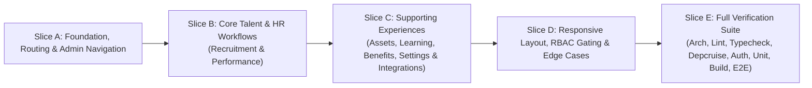

# Phase 12 — Prioritized Implementation Roadmap (`btn-hrms`)

## 1. Vertical Slice Execution Strategy

To deliver a complete, verified frontend without breaking existing E2E or architectural contracts, implementation is organized into **5 incremental vertical slices**:

---

## 2. Prioritized Task Breakdown (P0 $\rightarrow$ P3)

### Priority P0 — Critical UX Fixes, Broken Links & UUID Elimination

| ID | Slice | Module / File | Task Description | Verification |
| --- | --- | --- | --- | --- |
| **P0-1** | Slice A | `src/proxy.ts` & `src/features/recruitment/components/offers-view.tsx` | Fix broken `<Link href='/approvals'>` in `OffersView` to point to `/administration/approval`, and add legacy redirect `/approvals` $\rightarrow$ `/administration/approval` in `src/proxy.ts`. | Unit / E2E navigation check |
| **P0-2** | Slice A | `src/app/(protected)/administration/layout.tsx` | Add `/admin/integrations` (`Tích hợp & Webhook`) and `/admin/settings` (`Cấu hình hệ thống`) tabs to `AdministrationLayout` so admins can navigate seamlessly across all governance tools. | `authorization:check` & UI verification |
| **P0-3** | Slice B | `src/features/recruitment/components/requisitions-view.tsx` | Replace raw `departmentId` UUID text input in `CreateRequisitionDialog` with a human-readable Department `<Select>` populated from `useDepartmentsQuery()` (`@/features/employees`). Add status filter `<Select>` to the toolbar. | Typecheck, Depcruise & UI test |
| **P0-4** | Slice B | `src/features/recruitment/components/postings-view.tsx` | Replace raw `requisitionId` UUID text input in `PublishPostingDialog` with a human-readable Requisition `<Select>` populated from `requisitionsQueryOptions`. | Typecheck, Depcruise & UI test |
| **P0-5** | Slice B | `src/features/performance/components/goals-view.tsx` | Fix bug where `Mô tả` (Description) column hardcoded `'—'` instead of rendering `row.description || '—'`. Gate `Duyệt` action behind `performance:manage` permission. | Typecheck & UI check |
| **P0-6** | Slice B | `src/features/performance/components/reviews-view.tsx` & `cycles-view.tsx` | Replace raw `employeeId` and `reviewerId` UUID inputs in `Assign Reviewer` dialog with Employee `<Select>` dropdowns populated from `employeesQueryOptions`. Gate admin-only buttons behind `performance:manage`. | Typecheck, Depcruise & UI test |
| **P0-7** | Slice C | `src/features/asset-management/components/{inventory,requests,issues}-view.tsx` | Resolve raw `assetTypeId`, `requesterEmployeeId`, and `employeeId` UUIDs to human-readable Asset Names/SKUs and Employee full names. Add top-level `"Nhập kho thiết bị"` dialog in `InventoryView` and status filter `<Select>` in `RequestsView`. | Typecheck, Depcruise & UI test |
| **P0-8** | Slice C | `src/features/settings/components/*.tsx` & `src/app/(protected)/admin/integrations/page.tsx` | Wire dead `"Save"` buttons in `FeatureFlagsCard`, `SecurityConfigCard`, and `ObservabilityConfigCard` with `localStorage` persistence, reset capability, and `toast.success` feedback. Wire `AdminIntegrationsPage` `"Configure"` dialog and real `/api/v1/monitoring/system-health` ping on `"Test"`. | Typecheck & UI verification |

### Priority P1 — High-Value Backend-Supported Workflow Completion

| ID | Slice | Module / File | Task Description | Verification |
| --- | --- | --- | --- | --- |
| **P1-1** | Slice B | `src/features/recruitment/api/queries.ts` & `components/candidates-view.tsx` | Wire `POST /api/v1/recruitment/applications` (`useCreateCandidateApplicationMutation`) and `POST /api/v1/recruitment/applications/:id/cv` (`useUploadCandidateCvMutation`). Add Job Posting `<Select>` selector, `"Thêm ứng viên"` dialog, and `"Đính kèm CV"` dialog in `CandidatesView`. | Typecheck & API integration check |
| **P1-2** | Slice C | `src/features/benefits/api/queries.ts` & `components/{plans,enrollments}-view.tsx` | Add `employerContribution`, `employeeContribution`, and `description` inputs to `PlansView` create dialog; gate admin actions with `benefits:manage`. Wire `POST /api/v1/benefits/dependents` and add `"Thêm người phụ thuộc"` dialog in `EnrollmentsView`. | Typecheck & API integration check |
| **P1-3** | Slice C | `src/features/learning/api/queries.ts` & `components/{courses,certifications,paths}-view.tsx` | (1) Add `estimatedHours` input to course creation, display `"Khóa học của tôi"` enrollments (`GET /api/v1/learning/enrollments`) with `"Hoàn thành"` action (`POST .../complete`). (2) Add `"Cấp chứng chỉ"` (`POST /learning/certifications/issue`) and Employee Certificate lookup (`GET /learning/certifications/employee/:id`) with Renew/Revoke actions. (3) Add Learning Path assignment (`POST /learning/paths/assign`) & completion (`POST /learning/paths/:id/complete`). Gate admin controls with `learning:manage`. | Typecheck & API integration check |

### Priority P2 & P3 — Polish, Quality Gates & E2E Regression

| ID | Slice | Scope | Task Description |
| --- | --- | --- | --- |
| **P2-1** | Slice D | Responsive & Empty/Error States | Ensure all enhanced views handle loading, empty, and error states cleanly and render responsive action toolbars across mobile (`375px`), tablet (`768px`), and desktop (`1280px+`). |
| **P3-1** | Slice E | Automated Verification | Run `pnpm lint`, `pnpm --filter @project/api arch:check`, `pnpm --filter frontend typecheck`, `pnpm --filter frontend depcruise`, `pnpm --filter frontend authorization:check`, `pnpm test:web`, `pnpm build`, and Playwright E2E suite. |
